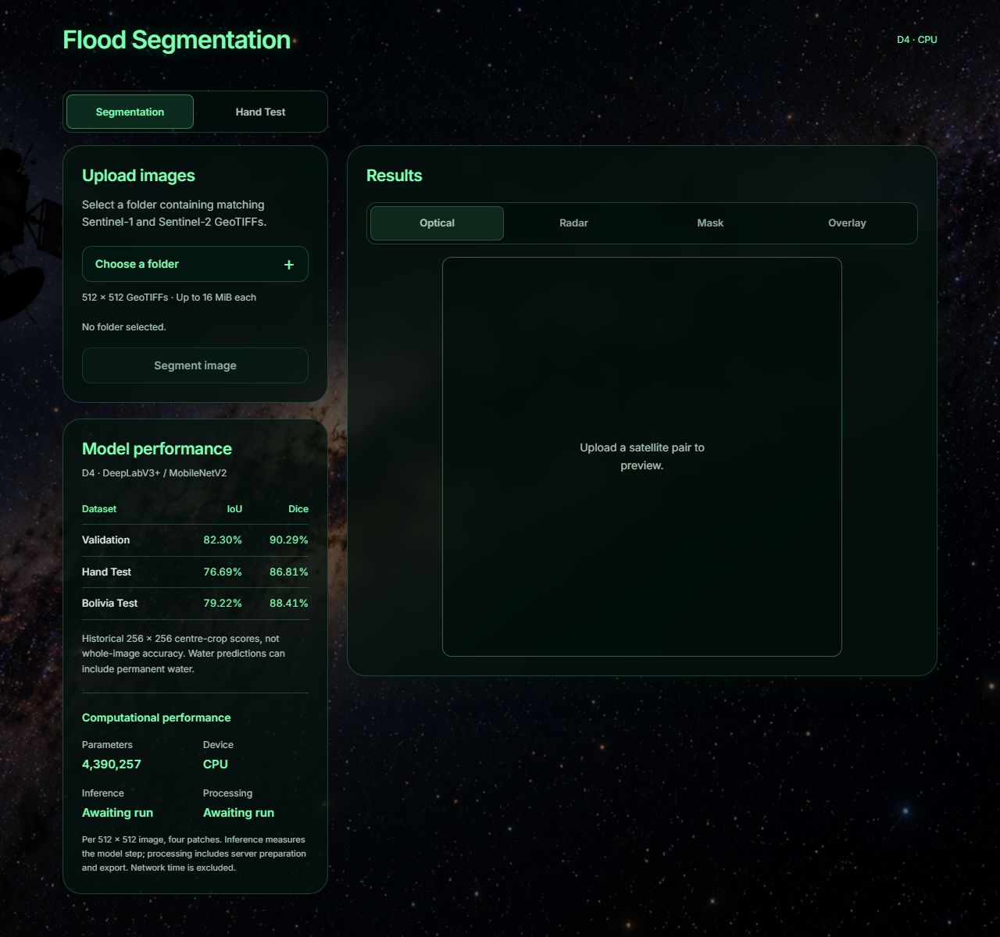
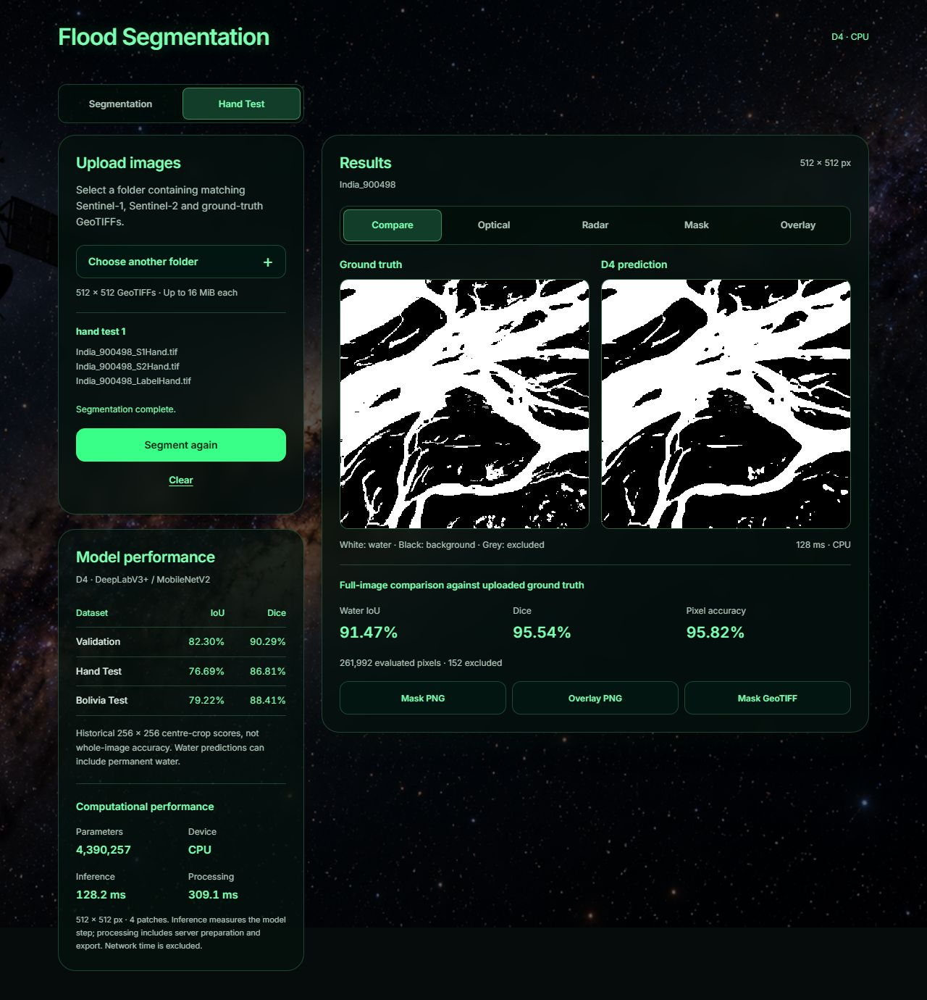
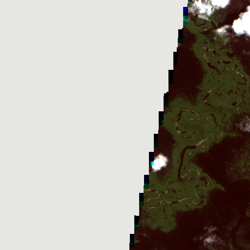
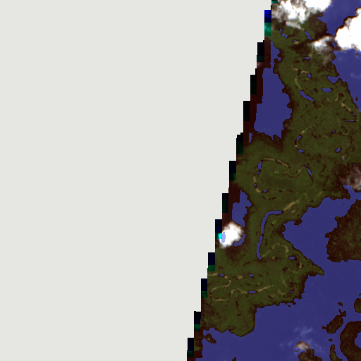

# Flood segmentation: D4 demo

A local web workspace for predicting water in paired Sentinel-1 and Sentinel-2 satellite imagery. The application loads the existing FYP D4 DeepLabV3+ / MobileNetV2 checkpoint. It does not train a model.

The **Hand Test** tab also accepts a matching ground-truth mask and compares it with a fresh prediction, side by side.



## Run with Docker

Install and start Docker Desktop (Linux containers on Windows). The initial build downloads dependencies; Python and Node.js do not need to be installed on the host.

```sh
git clone https://github.com/azfario/FYP-demo-app.git
cd FYP-demo-app
docker compose up --build
```

Open **http://localhost:8080**. The default backend uses CPU-only PyTorch. The repository is private, so cloning requires access to the `azfario/FYP-demo-app` repository.

```sh
# Stop the application
docker compose down

# View startup or inference errors
docker compose logs backend
```

Only the frontend port is exposed, bound to `127.0.0.1:8080`. Nginx forwards API requests to the internal FastAPI service. One backend worker loads one model instance; predictions are serialized to bound model memory use.

## Upload a folder

1. Choose **Choose a folder** and select `sample/bolivia 1`, or any other numbered tile folder.
2. Wait for the optical preview and the message **Ready to segment.**
3. Choose **Segment image**.
4. Switch between Optical, Radar, Mask, and Overlay. Adjust overlay opacity and download a PNG or georeferenced mask TIFF.

Each folder contains exactly one matching pair, for example:

```text
sample/bolivia 1/
  Bolivia_103757_S1Hand.tif
  Bolivia_103757_S2Hand.tif
```

Select a single `bolivia N` folder, not the entire `sample` directory. Samples are provided in the repository; the interface has no sample gallery. Common operating-system metadata files are ignored. Developer sample ZIP endpoints remain available through the API.

All **15 folders contain 30 original TIFFs**. `sample/manifest.json` maps the numbered folders to the original Bolivia test-list order. Original filenames are preserved. Labels are not included or required for prediction.

## Supported inputs

### Hand Test comparison

1. Open **Hand Test** and choose one directory such as `hand test/hand test 1`.
2. The directory must contain one matching `_S1Hand.tif`, `_S2Hand.tif` and `_LabelHand.tif`.
3. The ground truth appears beside an empty prediction placeholder. Click **Segment image** to run D4.
4. Compare both masks and read **Water IoU**, **Dice** and **Pixel accuracy** below them. Optical, Radar, Mask, Overlay, opacity and prediction downloads remain available.

The repository includes exactly **10 selected triplets (30 original TIFFs, approximately 37.4 MiB)** under `hand test/`. Folder mapping, selection reasons, source split and checksums are in its manifest and README. These are visually selected river/floodplain examples, not a representative benchmark of all 90 Hand Test tiles. No Hand Test gallery or automatic sample loading is provided.

Comparison scores cover the full 512 × 512 image, using only pixels valid in both imagery and reference. Labels are `0=background`, `1=water`, `-1/255=ignored`; zero remains background even when nodata metadata says zero. Both comparison masks show excluded pixels in grey. Water IoU is `TP/(TP+FP+FN)`, Dice is `2TP/(2TP+FP+FN)`, and pixel accuracy is `(TP+TN)/evaluated pixels`. An undefined denominator displays **N/A**. Accuracy can be dominated by background, so assess IoU/Dice and the masks together.

Ground truth is used only for scoring and display, never as model input. Uploads remain temporary. Tabs retain independent completed results and cannot be switched while validating or predicting. Historical 256 × 256 centre-crop scores stay separate from these uploaded-image scores. Prediction exports retain the original model mask; the grey comparison exclusion display does not alter exported predictions.

Each Hand Test file may be up to 16 MiB, with 48 MiB total TIFF content plus bounded multipart overhead. The ground truth must be a single-band GeoTIFF with matching tile ID, 512 × 512 dimensions, coordinate system and grid. No resizing or reprojection is performed.



### Satellite input requirements

- Original Sen1Floods11-style 512 × 512 GeoTIFFs, no larger than 16 MiB per file.
- Matching tile IDs, coordinate systems, raster transforms, dimensions, and expected band descriptions.
- S1 bands: `VV, VH`, in dB.
- S2 bands: `B1, B2, B3, B4, B5, B6, B7, B8, B8A, B9, B10, B11, B12`, original Level-1C reflectance scaled by 10000.
- Ordinary RGB pictures, S1 alone, S2 alone, renamed unrelated rasters, and arbitrary satellite products are unsupported.

The browser sends the two files as multipart fields `s1` and `s2`; a directory path is not transmitted. Images are decoded in memory, with upload streams closed after validation. Multipart handling may use temporary spool files that are closed after the request. No uploaded imagery or prediction history is retained by the application.

## D4 model and interpretation

- D4, seed **2026**, `attempt_001`, final checkpoint selected at fine-tuning epoch 27 by validation IoU.
- DeepLabV3+ / MobileNetV2, **4,390,257 parameters**, 15 input channels, output stride 16, ASPP rates `(3, 6, 9)`.
- The bundled weights load strictly and are verified by SHA256. No ImageNet weights or model files are downloaded at runtime.
- S1: replace nonfinite raw values with zero, clip to `[-50, 1]`, scale with `(x + 50) / 51`.
- S2: apply the bundled training-only per-band means and standard deviations, `(x - mean) / (std + 1e-6)`; invalid raster values become normalized zero.
- Channel order: two S1 bands, followed by thirteen S2 bands. Prediction uses `sigmoid(logits) > 0.5`.
- A full 512 × 512 image is processed as four non-overlapping 256 × 256 patches. No resizing or centre-only cropping occurs in the app. Patch boundaries can affect predictions.
- Pixels without usable paired imagery are marked no-data in the exported mask. GeoTIFF values are `0 = background`, `1 = predicted water`, `255 = no data`; the source coordinate system and transform are preserved.
- Display-only 2nd/98th-percentile contrast stretching creates optical/radar previews. It does not alter model inputs. Optical display uses B4/B3/B2, radar display uses VV.
- Water segmentation can indicate flooding. It does not distinguish newly flooded land from permanent water, and this research demonstration is not a warning system.

### Historical scores

These are the recorded **central 256 × 256 crop evaluations**, not measurements of the whole-image app output:

| Dataset | IoU | Dice |
| --- | ---: | ---: |
| Validation | 82.30% | 90.29% |
| Hand Test | 76.69% | 86.81% |
| Bolivia Test | 79.22% | 88.41% |

Source: original D4 seed 2026 checkpoint metadata and test evaluation CSV. Bolivia was already used for held-out testing. Reusing these samples is a demonstration, not a new independent evaluation. Runtime inference timing is measured separately for each request and includes patch transfer and model prediction; total backend processing additionally includes parsing and rendering. Neither includes the browser's network/download time.

## Optional NVIDIA GPU

With compatible NVIDIA drivers and Docker GPU support configured:

```sh
docker compose -f compose.yaml -f compose.gpu.yaml up --build
```

The GPU override builds PyTorch 2.7.1 / torchvision 0.22.1 with CUDA 11.8 and requests one NVIDIA GPU. Device selection occurs automatically in the backend container. The UI displays the device actually used. CPU users do not need CUDA or NVIDIA drivers. See [Docker GPU configuration](https://docs.docker.com/compose/how-tos/gpu-support/).

After building once, subsequent startup with the cached images can run offline:

```sh
docker compose up --no-build --pull never
```

Fonts, sample imagery, preprocessing metadata, model weights, and Swagger documentation assets are bundled. The prediction workspace and API documentation have no external runtime asset dependency.

## API

Interactive documentation: **http://localhost:8080/docs**.

| Method | Endpoint | Purpose |
| --- | --- | --- |
| GET | `/api/health` | Model readiness and actual inference device |
| GET | `/api/model-info` | Model provenance, configuration, and historical metrics |
| POST | `/api/preview` | Validate two uploaded TIFFs and return display previews |
| POST | `/api/predict` | Full-image prediction, PNG data URLs, base64 GeoTIFF, timing |
| POST | `/api/hand-test/preview` | Validate `s1`, `s2`, `ground_truth`; return optical, radar and reference previews |
| POST | `/api/hand-test/predict` | Prediction outputs plus comparison images, full-image scores and pixel/confusion counts |
| GET | `/api/samples` | Sample manifest and download/thumbnail URLs |
| GET | `/api/samples/{id}/thumbnail` | Optical preview of a bundled sample |
| GET | `/api/samples/{id}/download` | ZIP containing a matching pair |

Example:

```sh
curl -X POST http://localhost:8080/api/predict \
  -F 's1=@sample/bolivia 1/Bolivia_103757_S1Hand.tif' \
  -F 's2=@sample/bolivia 1/Bolivia_103757_S2Hand.tif'
```

## Development and tests

Use Python 3.11 and a supported Node.js version (the Docker build uses Node 24). All frontend dependencies are locked with `package-lock.json`.

```sh
python -m venv .venv
# Linux/macOS: source .venv/bin/activate
# Windows PowerShell: .\.venv\Scripts\Activate.ps1
python -m pip install torch==2.7.1 torchvision==0.22.1 --index-url https://download.pytorch.org/whl/cpu
python -m pip install -r backend/requirements-test.txt
python -m pytest
python -m uvicorn backend.main:app --host 127.0.0.1 --port 8000
```

In another terminal:

```sh
cd frontend
npm ci
npm test
npm run dev
```

Vite proxies the API to port 8000. The tests verify original-notebook preprocessing and centre-crop predictions, full-image inference on all 15 pairs, patch placement, GeoTIFF alignment, input validation, sample downloads, unavailable-model behaviour, and CUDA agreement when a GPU is exposed. The committed reference fixture was generated independently from the original training notebook, not from the app's model/preprocessing implementation.

Hand Test tests additionally cover the ten triplets, independently recomputed metrics, ignored labels, empty-water cases, nodata=0, geographic mismatches and proof that swapping only ground truth leaves exported predictions unchanged.

With the Docker app running on port 8081, run `python scripts/check_deployment.py` to compare served assets with the local production build and independently score all ten triplets through Nginx. Run the frontend production build first. This script uses the app's NumPy/Rasterio dependencies.

Optional isolated-browser checks use Playwright, save real screenshots under `docs/screenshots/`, and save downloads and their report under the ignored `test-results/ui/` directory. From the repository root in PowerShell:

```powershell
npm.cmd --prefix frontend install --no-save --package-lock=false playwright@1.62.1
$env:NODE_PATH = "$PWD\frontend\node_modules"
& .\frontend\node_modules\.bin\playwright.cmd install chromium
node scripts/check_ui.cjs
```

Set `UI_BASE_URL` to change the browser test address. `PLAYWRIGHT_CHROMIUM_EXECUTABLE` optionally selects an existing Chromium executable; otherwise Playwright uses its installed browser. These are testing dependencies, not runtime app requirements.

## Troubleshooting

- **Cannot connect to Docker:** start Docker Desktop, select Linux containers, and wait for its engine to be ready.
- **Startup is taking time:** the first build downloads Python/Node packages and PyTorch. Follow `docker compose logs backend` after the build.
- **Port 8080 is occupied:** choose another host-side port without changing the other service. In PowerShell, run `$env:FYP_APP_PORT="8081"`, then `docker compose up --build`. In a POSIX shell, run `FYP_APP_PORT=8081 docker compose up --build`. Open `http://localhost:8081`. The repository default remains 8080.
- **Model unavailable:** restore the original bundled files under `models/`; checksum mismatches fail startup rather than silently loading different weights.
- **Wrong band order or alignment:** use the original matching sample TIFFs. Renaming a file does not change its contents or make it compatible.
- **GPU unavailable:** verify Docker's NVIDIA GPU support. Use the CPU command while resolving GPU setup.
- **Directory picker is unavailable:** use a current desktop browser supporting folder selection. No ZIP upload is implemented.

## Stack and design

React / Vite / Tailwind / Axios frontend; FastAPI / PyTorch / Rasterio / NumPy / Pillow / OpenCV backend; Nginx; Docker Compose. No database, accounts, or cloud hosting.

The UI keeps the original satellite-and-star-field background, with dark transparent panels, self-hosted Inter, neon green controls and a compact model-performance table. Computational performance shows the model parameter count, actual device, measured inference latency and server processing time for each prediction. Timings cover the full image's four patches and exclude network time; no runtime figures are invented before prediction. The background and all runtime assets are bundled locally. See `docs/DESIGN_NOTES.md` for decisions and image-generation provenance, and `docs/VERIFICATION.md` for testing and the antislop Delivery Gate.

### Actual prediction example

Bolivia_103757, rendered by the CPU Docker backend. Grey areas have no usable paired imagery.

| Optical preview | Predicted water overlay |
| --- | --- |
|  |  |

These are prediction images. Real interface screenshots are available in [desktop results](docs/screenshots/desktop-results.jpg), [tablet results](docs/screenshots/tablet-results.jpg), and [mobile results](docs/screenshots/mobile-results.jpg).

## Dataset attribution

Sample imagery is from [Sen1Floods11, Cloud to Street](https://github.com/cloudtostreet/Sen1Floods11), version 1.1. Original georeferencing and metadata are retained.

Bonafilia, D., Tellman, B., Anderson, T., and Issenberg, E. (2020). *Sen1Floods11: A georeferenced dataset to train and test deep learning flood algorithms for Sentinel-1.* IEEE/CVF CVPR Workshops, pp. 210–211. [Paper](https://openaccess.thecvf.com/content_CVPRW_2020/html/w11/Bonafilia_Sen1Floods11_A_Georeferenced_Dataset_to_Train_and_Test_Deep_Learning_CVPRW_2020_paper.html).

The trained checkpoint is the project owner's FYP research artifact. This repository does not grant a new license to third-party data or to the model.
